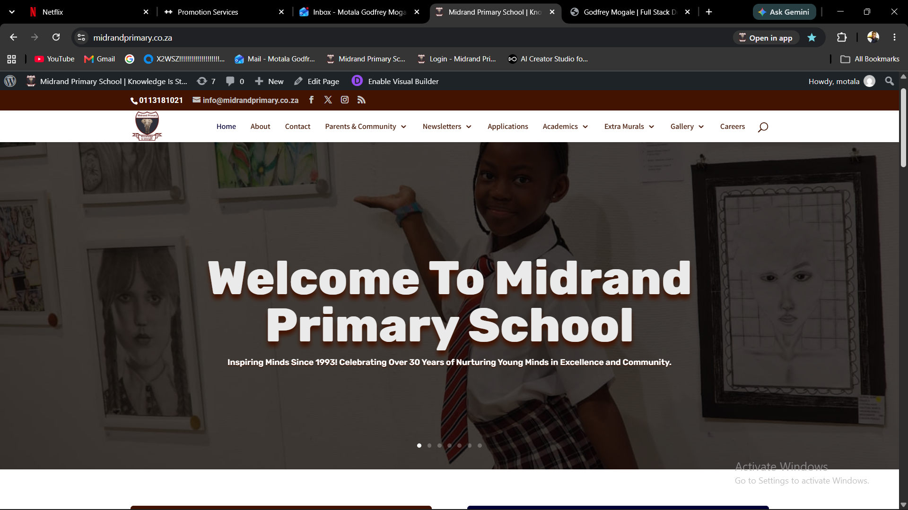

# Godfrey Mogale – Portfolio

Modern dark-themed developer portfolio.

## How to use

1. Open the folder `godfrey-mogale-portfolio`
2. Double-click `index.html` **or**
3. Put the folder inside Laragon’s `www` folder and open:
   `http://godfrey-mogale-portfolio.test`

## How to add your photo

1. Create a folder called `images` inside this portfolio folder
2. Put your photo there (e.g. `godfrey.jpg`)
3. Open `index.html`
4. Find the section with class `about-photo`
5. Replace the placeholder with:

```html

```

## How to add project screenshots

For each project card:

1. Take a good screenshot of the system
2. Save it in the `images` folder (example names):
   - `midrand-primary.png`
   - `requisition-system.png`
   - `parent-teacher-app.png`
3. Inside each `.project-image` div, replace the entire `.placeholder-content` block with:

```html

```

## Update Live Demo & GitHub links

In each project card, change the `href="#"` of the “Live Demo” button to your real link when you host the project.

You can also create separate GitHub repositories for each project and update the “View Code” links.

## Contact links (already filled)

- Email: tshepisogodfrey@gmail.com
- LinkedIn: https://www.linkedin.com/in/motala-godfrey-mogale-b4ba165a
- GitHub: https://github.com/Motala19

---

Built for Godfrey Mogale – Full Stack Developer (Midrand, Johannesburg)
